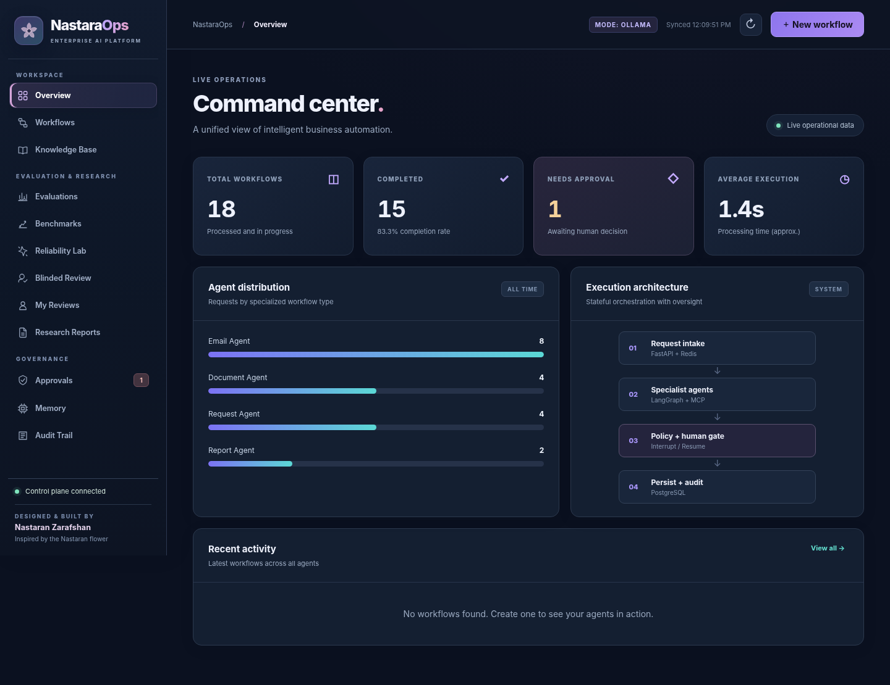
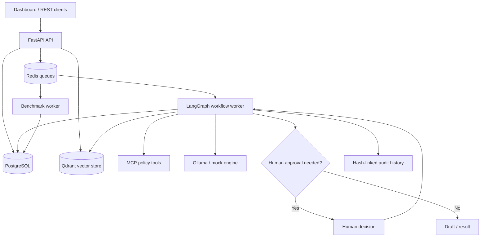

<div align="center">


# NastaraOps

**Enterprise Multi-Agent AI Platform**

*Orchestrate intelligently. Ground with evidence. Keep humans in control.*

**Designed & Built by Nastaran Zarafshan**

[Overview](#overview) · [Features](#capabilities) · [Architecture](#architecture) · [Quick Start](#quick-start-windows) · [Testing](#testing--continuous-integration) · [Research](#research--limitations)


</div>



*Illustrative interface preview — no private customer information or human review records are shown.*

## Overview

**NastaraOps** is a local-first reference platform for orchestrating and evaluating AI-assisted workflows. It combines **FastAPI**, **LangGraph**, **MCP tools**, **PostgreSQL**, **Redis**, **Qdrant**, and optional on-device **Ollama** inference in a single operational dashboard.

The system demonstrates how agentic workflows can be **queued, governed, evaluated and audited** without automatically executing sensitive real-world actions. Human approval is a first-class part of the workflow, and knowledge-grounded agents can identify when information is **not supported** by retrieved documentation.

> **Project scope:** An engineering and research portfolio implementation. It is not an independently audited, production-ready, multi-tenant service.

## Capabilities

| Orchestration & AI | Evidence & governance | Engineering |
|:--|:--|:--|
| LangGraph workflow execution | Human approval and rejection gates | FastAPI REST API and web dashboard |
| Request, email, document and report routing | SHA-256-linked audit events | Redis-backed job processing |
| Local Qwen 2.5 inference via Ollama | Qdrant semantic retrieval and citations | PostgreSQL persistence and checkpoints |
| Mock mode for deterministic development | Unsupported-question detection | MCP policy tools and isolated Pytest suite |
| Workflow inspection and operational status | Historical research reports and evaluations | Python 3.11 on Windows; Docker infrastructure |

### Tested demonstrations

The following behaviors have been **manually exercised in a local environment**:

- A request workflow is queued, processed and completed by the LangGraph worker.
- A sensitive refund request is paused for review, rejected and recorded in the audit trail.
- An approval-gated email draft resumes after a human decision; no real email is sent.
- The audit chain was verified after a series of workflow events.
- Ollama Qwen 2.5 3B generated a draft for a delayed-delivery request.
- A demo returns policy was retrieved with a citation; unsupported price/warranty questions were explicitly left unanswered.

These are **examples**, not benchmark claims about model accuracy, enterprise security or reliability under load.

## Architecture



**Local deployment:** The Python application (API, MCP, and workers) runs inside a Windows `.venv`. Docker Desktop runs **PostgreSQL, Redis and Qdrant only**. Ollama is installed separately on the host when real model inference is desired.

## Quick Start (Windows)

**Requirements:** Windows 10/11; **Python 3.11 (64-bit)**; Docker Desktop with Linux containers and Compose; PowerShell; network access for initial package/image downloads. A GPU is optional for mock mode.

### 1. Create the Python environment

Extract the project, open PowerShell in its root, and run:

```powershell
cd D:\projects\NastaraOps
powershell.exe -NoProfile -ExecutionPolicy Bypass -File .\scripts\setup.ps1
```

Setup creates `.venv`, installs `requirements.txt` and generates `.env` with private, random credentials **only if the file does not already exist**. Never commit `.env`.

If the Python launcher cannot find a manual Python installation, consult [Operations](docs/OPERATIONS.md). Python 3.11 is required; Python 3.13 need not be uninstalled.

### 2. Start the platform

Open Docker Desktop, then execute:

```powershell
powershell.exe -NoProfile -ExecutionPolicy Bypass -File .\scripts\start.ps1
```

| Endpoint | Local address |
|:--|:--|
| Dashboard | http://127.0.0.1:8010 |
| API documentation | http://127.0.0.1:8010/docs |
| Health | http://127.0.0.1:8010/health |

Copy the value of `API_KEY` from your **local** `.env` into the dashboard. Never paste it in an issue, screenshot or public commit.

### 3. Enable a local model (optional)

Install [Ollama](https://ollama.com/download/windows), then:

```powershell
ollama pull qwen2.5:3b
ollama pull bge-m3
```

In `.env`, set:

```dotenv
LLM_MODE=ollama
OLLAMA_BASE_URL=http://127.0.0.1:11434
OLLAMA_MODEL=qwen2.5:3b
OLLAMA_EMBED_MODEL=bge-m3
```

Restart using the stop/start scripts. **Mock mode** (`LLM_MODE=mock`) is sufficient for deterministic workflow tests; Qwen is used for actual local inference. `bge-m3` provides embeddings for knowledge-base retrieval.

### 4. Stop safely

```powershell
powershell.exe -NoProfile -ExecutionPolicy Bypass -File .\scripts\stop.ps1
```

Logs are written to `.local/`. Do **not** use `docker compose down -v` when you want to preserve databases and audit history. This project has its own Compose identity, `nastaraops-native`, and does not share the previous AgentOps database by default.

## Example: A grounded support answer

1. Open **Knowledge Base** and upload `examples/knowledge_base/premium-wireless-headphones-demo.md`.
2. Test semantic retrieval for the defective-product return window.
3. Open **Workflows**, create an **Email agent** draft and ask for the documented return period and the warranty duration.
4. Inspect the response: the **fictional** 30-calendar-day return window has evidence; warranty duration is **not provided** and should be flagged as unsupported.

The source is explicitly labeled **demo/synthetic** and must never be presented as a real company policy.

## Testing & Continuous Integration

The project includes **41 isolated Pytest cases**, reported passing on a Windows Python 3.11 environment (`41 passed in 3.08s`). These tests cover deterministic grounding, chunking, policy enforcement, audit hashing, API contract checks and LangGraph pause/resume with in-memory checkpoints.

Run them locally:

```powershell
.\.venv\Scripts\python.exe -m pip install -r requirements-test.txt
.\.venv\Scripts\python.exe -m pytest -q tests
.\.venv\Scripts\python.exe scripts\check_research.py
```

**GitHub Actions:** `.github/workflows/ci.yml` runs the isolated suite and integrity checks on Python 3.11 for `push`, `pull_request` and manual dispatch. It does not require Docker, Ollama, live credentials or a real PostgreSQL database. **Its remote success must be verified after publishing.**

This first CI workflow deliberately does not include project-wide Ruff linting; lint rules will be introduced incrementally after baseline configuration. See [Testing guide](docs/TESTING.md).

## Research & Limitations

The bundled [research report](reports/public/RESEARCH_REPORT.md) and [metrics](reports/public/research_metrics.json) are a **historical frozen snapshot**, not results of the current 41 unit tests. That study contains 100 synthetic holdout cases drawn from 25 source clusters, two repeated local Qwen 2.5 3B evaluations and a single reviewer's 100 first-vote labels. Reported historical mean accuracy was **82%** and mean Macro-F1 was approximately **82.53%**. It did **not** establish independent inter-rater reliability or production generalization.

Evidence hashes and report provenance can be checked with:

```powershell
.\.venv\Scripts\python.exe scripts\check_research.py
```

**Known limits:** a shared development API key is not production identity management; similarity scores are not correctness probabilities; cited text can still be misleading; no production service-level objectives or security audit are claimed. Human review records and persistent data require careful handling.

## Repository layout

```text
NastaraOps/
├── app/                  # API, agents, workers, RAG, UI
├── tests/                # 41 isolated unit/contract tests
├── .github/workflows/     # Python CI
├── docs/                 # Operations, test guide and roadmap
├── examples/             # Synthetic-only evaluation data
├── reports/public/       # Historical research provenance
├── scripts/              # Windows PowerShell + research helpers
├── docker-compose.yml    # Database/queue/vector infrastructure
├── requirements.txt      # Runtime Python packages
├── requirements-test.txt # Test packages
└── README.md
```

## Security, contribution and license

Read [SECURITY.md](SECURITY.md) before exposing any service publicly or contributing data. Do not commit `.env`, `.local/`, private reviews, credentials or volume contents. Automated tests are intentionally read-only with respect to real infrastructure; integration tests should use **disposable** environments.

Contributions and reproducibility notes are in [CONTRIBUTING.md](CONTRIBUTING.md). Distributed under the [MIT License](LICENSE).

---

<div align="center">

**NastaraOps** · *Intelligence with structure. Automation with oversight.*

**Designed & Built by Nastaran Zarafshan**

</div>
